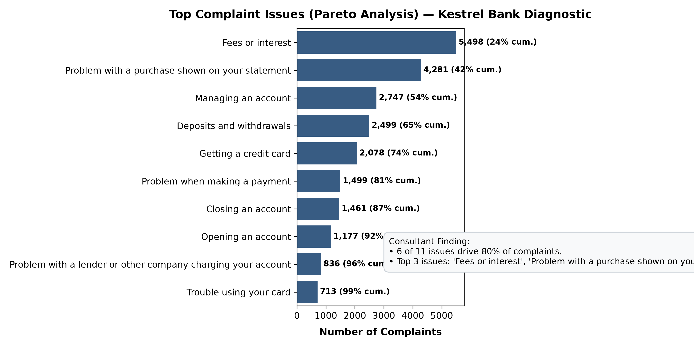
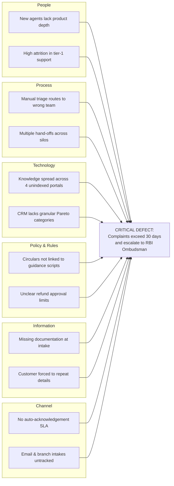

# A1 Root Cause Analysis: Pareto, Narratives & 5 Whys
**Project**: Kestrel Bank Complaint Process Diagnostic | **Week**: 2  

---

## 1. Measured Baseline Performance (N = 23,046 Records)

Derived from the 24-month filtered banking dataset (`01_A1_diagnostic/data/clean/complaints_clean.csv`):

| Baseline KPI | Measured Value | Benchmark / Target | Interpretation & Strategic Value |
| :--- | :---: | :---: | :--- |
| **Total Complaints in 24M Window** | **23,046** | — | Focuses on Retail Cards & Checking/Savings. |
| **Average Complaints per Month** | **960** | 40,000 (Scaled Client) | Stand-in data captures problem shape and distribution. |
| **Timely Response Rate** | **94.0%** | $\ge 95.0\%$ | 6% fail statutory turnaround at the threshold. |
| **Median Routing Lag** | **0.0 days** | $\le 1.0$ day | Intake is fast; delay occurs *during* investigation. |
| **Share Closed with Relief** | **30.6%** | $< 20.0\%$ | Over 30% had valid customer grounds and were avoidable. |
| **Digital Web Intake Share** | **72.0%** | $\ge 70.0\%$ | High digital adoption makes text-based AI viable. |
| **Narrative Documentation Share**| **34.8%** | — | Sufficient text for qualitative NLP & theme extraction. |
| **Flagged Invalid Date Rows** | **0** | 0 | Strict data hygiene confirmed (zero silent fixes). |

---

## 2. Pareto Analysis (80/20 Rule)

From `01_A1_diagnostic/notebooks/a1_step3_pareto.py`:

> **Consultant Finding**: **6 of 11 issue categories account for 81.4% of all bank complaints.**  
> Top three drivers:
> 1. **Fees or interest** (23.9% of volume)
> 2. **Problem with a purchase shown on your statement** (18.6% of volume)
> 3. **Managing an account** (11.9% of volume)

### High-Relief Target Identification
An issue that is **both frequent and has a high relief rate** is the primary candidate for root-cause elimination:
* **Closing an account**: 31.8% relief rate (customers charged maintenance after closure requests).
* **Deposits and withdrawals**: 31.5% relief rate (technical transaction hold delays).
* **Fees or interest**: 31.0% relief rate (unnotified fee revisions or incorrect waiver rejections).

---

## 3. Qualitative Narrative Audit (100 Sample Review & Clustering)

Numbers identify *where* complaints occur; unstructured text reveals *why*.

### Audit Results (100 Sample Narratives)
* **Process Breakdown (36%)**: Complaints bouncing between branch staff and contact center; lack of cross-team coordination.
* **Policy Ambiguity (35%)**: Inconsistent waiver rules, uncommunicated fee schedule updates, rigid automated debit rules.
* **Information / Knowledge Access (16%)**: Agents unable to locate governing RBI circulars or product terms; conflicting answers across shifts.
* **Customer Understanding (13%)**: Legitimate charges that customers misunderstood due to opaque statement descriptions.

### AI Assistance Suitability Audit
* **Knowledge Retrieval (RAG) (51%)**: Direct policy lookup with cited circular clauses would resolve the agent's hesitation.
* **Triage & Smart Routing (36%)**: Misrouted complaints that landed on the wrong desk initially.
* **No AI Needed / Broken Policy (13%)**: The policy itself is broken or unfair. **AI must not be used to justify bad policies.**

---

## 4. Ishikawa (Fishbone) Diagram

---

## 5. The "5 Whys" Root-Cause Investigation

| Level | Question | Factual Root-Cause Finding |
| :---: | :--- | :--- |
| **Why 1** | Why are complaints slow to resolve? | Agents spend 12–15 minutes per case searching for applicable policies and historical precedents. |
| **Why 2** | Why does policy search take so long? | Bank guidelines and RBI regulatory circulars are fragmented across four disconnected intranet repositories. |
| **Why 3** | Why are there four disconnected repositories? | Each product team (Cards, CASA, Digital, Branch) maintains its own documentation without central indexing. |
| **Why 4** | Why does nobody own central indexing? | Complaint handling operations are measured solely on closure speed, not on knowledge freshness or accuracy. |
| **ROOT CAUSE**| **Governance & Ownership Gap** | **No designated owner or process exists for complaint knowledge. Operational fix: Establish clear knowledge ownership (Non-AI); then deploy an AI Knowledge Q&A tool to query the unified source.** |
