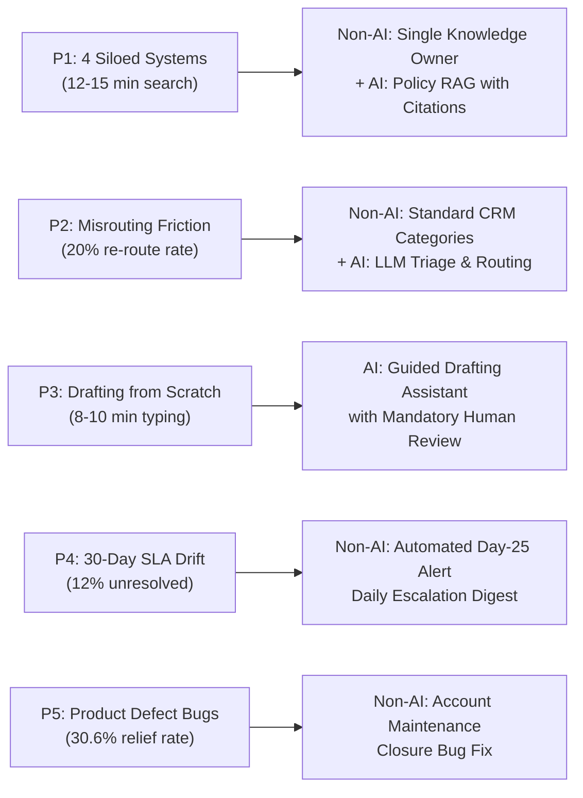

# Flagship A: Master Pain-Point Register
**Client**: Kestrel Bank | **Module**: 04_FlagshipA/discovery/03_pain_point_register.md | **Deliverable**: P1–P5 Baseline Mapping  

---

## 1. Prioritized Operational Pain Points

| ID | Operational Pain Point Description | Empirical Evidence & Grounding | Who Experiences It? | Frequency | Business Impact | Baseline Metric Tracked |
| :---: | :--- | :--- | :--- | :---: | :---: | :--- |
| **P1** | **Agents spend 12–15 min searching four disconnected systems for policy & circulars** | 51% of tagged narratives in A1 cite knowledge gaps; confirmed across 4 of 5 stakeholder interviews. | Frontline Complaint Agents | Every single complex complaint | **High** | Average Handle Time: **25.0 min baseline** (`AS-02`) |
| **P2** | **Complaints routed to the wrong specialist team upon initial intake** | 36% of tagged narratives in A1 cite triage friction; intake teams lack granular CRM categorization. | Agents, frustrated customers | ~1 in 5 complaints (20%) | **Medium** | Re-route rate: **~20%**; adds 2–3 days routing lag |
| **P3** | **Repetitive drafting of formal response letters from blank templates** | Stakeholder interviews reveal agents manually rewrite standard regulatory clauses repeatedly. | Frontline Agents | Every written response (~72% digital) | **Medium** | Reply drafting time: **8–10 min per case** |
| **P4** | **Unmonitored complaints drifting past the 30-day statutory threshold** | Process gap identified in A1; lack of automated alerting triggers Ombudsman exposure. | Principal Nodal Officer, Ops Lead | ~12% of total inflow (`AS-04`) | **High** | 30-day resolution rate: **88.0% baseline**; 3% Ombudsman rate |
| **P5** | **Repeat complaints stemming from preventable product/billing bugs** | A1 Pareto & Relief analysis: Account closure fees have a 31.8% relief rate; system bugs drive churn. | Aggrieved Customers, Bank Reputation | Top 2 Pareto categories | **High** | Avoidable complaint volume; **30.6% relief rate** |

---

## 2. Traceability from Pain Points to Strategic Interventions

