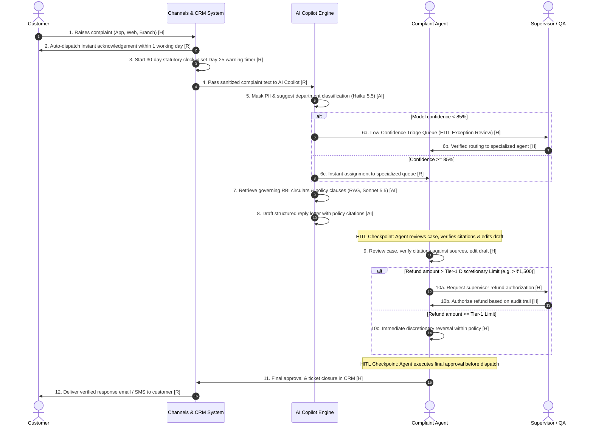

# Flagship A: To-Be Process Redesign & Human-in-the-Loop (HITL) Architecture
**Client**: Kestrel Bank | **Module**: 04_FlagshipA/process/to_be_bpmn.md | **Week**: 8  

---

## 1. To-Be Process Workflow (BPMN Swimlane Map)

Every step is strictly tagged:
* **[H]**: Human Decision / Action
* **[R]**: Automated Rule / Deterministic Workflow
* **[AI]**: AI Inference Call
* **[AG]**: Autonomous AI Agent (**Deliberately unused in this phase**)

---

## 2. Process Transformation Metric: Step Count Comparison

A side-by-side comparison reveals the operational shift from manual queues to automated workflow rules and AI assistance:

| Process Execution Tag | As-Is Baseline Count | To-Be Redesigned Count | Net Transformation |
| :--- | :---: | :---: | :---: |
| **[H] Human Touchpoints** | **11 steps** | **7 steps** | **-36% reduction in manual touchpoints** |
| **[R] Automated Rules** | **1 step** | **4 steps** | **+300% increase in deterministic SLA enforcement** |
| **[AI] Assisted Calls** | **0 steps** | **3 steps** | **Targeted deployment for triage, RAG & drafting** |
| **[AG] Autonomous Agents**| **0 steps** | **0 steps** | **Explicitly 0 (Preserves human accountability)** |

---

## 3. Mandatory Human-in-the-Loop (HITL) Guardrails

To comply with **RBI FREE-AI Sutras** and avoid regulatory exposure under **RB-IOS 2026**, full operational autonomy is strictly forbidden:

1. **Mandatory Response Approval**:  
   * *Rule*: No AI-generated draft may ever be transmitted directly to a customer.  
   * *Control*: The dispatch pipeline is technically locked until a human agent clicks "Approve & Send". Every sent message records the approving agent ID and an edit-distance score.
2. **Low-Confidence Triage Routing**:  
   * *Rule*: If the triage model's routing confidence score is $< 85\%$, the ticket bypasses automatic assignment and routes to a supervisor exception queue.
3. **Discretionary Financial Authority**:  
   * *Rule*: Frontline agents are granted ₹1,500 discretionary fee reversal authority (Non-AI fix #3). Refunds exceeding ₹1,500 require dual-authorization in the supervisor portal.

---

## 4. Interview Defense: "Why Didn't You Recommend an Autonomous Agent?"

> **The Big 4 Interview Answer**:  
> *"Because the decision ladder stopped earlier. In banking complaint handling, every high-value activity is either a retrieval task (RAG for policy search), an assisted draft, or an authoritative financial decision that bank policy and the RBI legally require a human to make.  
> An autonomous agent introduces unpredictable tool execution and unbounded risk without solving any found operational bottleneck. Autonomy in early phases would introduce regulatory non-compliance under the RBI FREE-AI framework. Narrow agentic automation is deferred to Phase 3 for purely internal backend data aggregation."*
