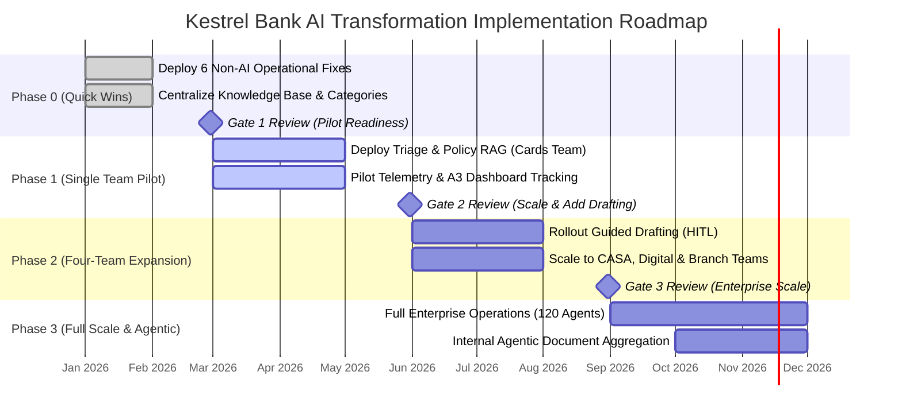

# Flagship A: 12-Month Phased Roadmap with Stage Gates
**Client**: Kestrel Bank | **Project**: Enterprise AI Transformation Blueprint | **Week**: 11  
**Module**: 04_FlagshipA/roadmap/roadmap_and_gates.md  

---

## 1. Phased 12-Month Implementation Timeline

---

## 2. Formal Stage-Gate Decision Criteria

Every gate represents a binding **Go / No-Go decision** governed by pre-agreed quantitative criteria:

| Stage Gate | Scheduled Date | Core Investment Decision | Mandatory "Go" Criteria (All Must Pass) |
| :---: | :---: | :--- | :--- |
| **Gate 1** | **Month 2** | **Approve Single-Team Pilot Go-Live** (Cards, 30 agents) | 1. Six Phase 0 non-AI fixes deployed and verified in CRM. 2. Information Security and DPDP privacy review signed off. 3. Central AI Registry entry approved by Risk Committee. 4. Evaluation test sets validated ($\ge 90\%$ triage, $\ge 85\%$ RAG). 5. Pilot team baseline handling time captured (25 min). |
| **Gate 2** | **Month 5** | **Approve 4-Team Expansion (120 agents) & Enable Reply Drafting** | 1. Agent Acceptance Rate $\ge 80.0\%$ over pilot. 2. Agent Override Rate $\le 15.0\%$. 3. **Zero unmasked PII leakage incidents**. 4. $\ge 60.0\%$ of pilot agents active weekly. 5. Ombudsman escalations trending downward vs. baseline. 6. Financial business case re-run with live pilot telemetry. |
| **Gate 3** | **Month 9** | **Approve Enterprise Steady-State & Narrow Agentic Steps** | 1. Gate 2 performance sustained for 3 consecutive months. 2. Measured financial payback confirmed $\le 24$ months. 3. Compliance and Legal sign-off on any proposed automation. 4. Unit cost confirmed $\le ₹3.00$ per complaint handled. |

---

## 3. Dedicated Change Management & Training Program
> *"The tornado analysis proved that Agent Adoption is the single largest determinant of project ROI. Change management is therefore treated as a primary engineering stream, not an afterthought."*

* **Frontline AI Champion Network**: Identify two respected senior agents in each of the four business units to serve as dedicated floor champions during initial rollout.
* **Role-Specific Training Program**: 2-hour interactive workshop covering prompt phrasing, reading citations, evaluating draft accuracy, and logging overrides.
* **Weekly 15-Minute Operational Huddles**: Weekly feedback sessions between frontline champions and the AI Product Owner to review rejected drafts and eliminate prompt friction.
* **Empowering Strategic Framing**: Reinforce in all executive and town-hall communications that **the AI Copilot eliminates administrative searching and typing; it does not replace banking professionals**.
